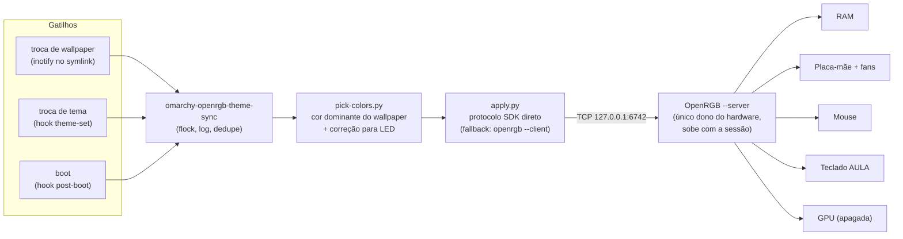

# openrgb-theme-sync

**O PC inteiro numa cor só, seguindo o seu wallpaper/tema — automaticamente, no Linux.**

RAM, placa-mãe, fans ARGB, mouse e teclado mudam de cor sozinhos sempre que você troca o wallpaper ou o tema do desktop. Em ~0,3 s. Sem cinco softwares proprietários brigando na bandeja, sem login, sem telemetria: só o [OpenRGB](https://openrgb.org) e alguns scripts.

> Feito e testado em Arch Linux + [Omarchy](https://omarchy.org) (Hyprland). A lógica é genérica — a seção [Como adaptar para o seu sistema](#como-adaptar-para-o-seu-sistema) mostra o que trocar para rodar em outra máquina/distro/desktop.

---

## O problema

No Windows, controlar o RGB de um PC com peças de marcas diferentes significa instalar iCUE, Armoury Crate, Mystic Light, RGB Fusion, Synapse... cada um com seu serviço, sua bandeja e seu login, e nenhum conversa com o outro. No Linux, a maioria desses softwares nem existe.

O OpenRGB resolve a parte do **controle unificado**: um programa só fala com todos os dispositivos. Mas ele não faz o RGB **acompanhar o visual do sistema**. Este projeto adiciona exatamente isso: *controle unificado que se pinta sozinho*.

## O que ele faz

1. **Mantém todo o RGB da máquina sob controle do OpenRGB**, permanentemente — inclusive após reboot.
2. **Extrai a cor dominante do wallpaper atual** (ou a cor de destaque do tema) e aplica em todos os dispositivos.
3. **Reage sozinho** a troca de wallpaper, troca de tema e boot.
4. **Corrige a cor para LED**: o hex de um tema é pensado para monitor (sRGB); mandado cru para o LED, sai "quase certo, mas não". O script lineariza, faz balanço de branco e normaliza o brilho.

---

## O hardware desta montagem

| Componente | Modelo | Como o OpenRGB fala com ele | Observação |
|---|---|---|---|
| CPU | AMD Ryzen 7 3700X | — | — |
| Placa-mãe | Gigabyte **B550 AORUS PRO** | HID USB (ITE IT5702, `048d:5702`) | 4 zonas: fita 12 V, `D_LED1`, `D_LED2`, placa |
| Fans | Hub ARGB com vários fans no header `D_LED` | via placa-mãe | zona precisa ser redimensionada (ver abaixo) |
| RAM | 2 pentes RGB com controlador **ENE** | I2C/SMBus do chipset AMD | só aparece com `acpi_enforce_resources=lax` |
| GPU | Gigabyte **RTX 3070 MASTER** | I2C da NVIDIA | LEDs queimados — o script a mantém apagada |
| Mouse | **Redragon M711 Cobra** | HID USB (`04d9:fc30`) | só modo `static` |
| Teclado | **AULA F75** wireless (dongle 2.4 GHz, `3554:fa09`) | HID, protocolo Sinowealth | **não suportado pelo OpenRGB oficial** → build customizada |

Cada linha dessa tabela custou um problema diferente — e cada um está documentado:

| Problema | Solução | Doc |
|---|---|---|
| RAM RGB não aparece em nenhum software | Conflito ACPI × SMBus; `acpi_enforce_resources=lax` na cmdline do kernel | [01](docs/01-ram-i2c-detection.md) |
| Teclado AULA não é reconhecido | Compilar o OpenRGB a partir da MR !3027 (draft) + contornos do `mbedtls3` do Arch | [02](docs/02-custom-openrgb-build.md) |
| OpenRGB sem permissão no teclado | Regra udev `uaccess` — que **precisa** ordenar antes de `73-seat-late.rules` | [03](docs/03-device-permissions-udev.md) |
| Teclado perde a cor quando o OpenRGB fecha | Servidor SDK persistente + clientes efêmeros | [04](docs/04-sdk-server-client-model.md) |
| Nada roda no boot (Hyprland não lê XDG autostart) | `autostart.lua` + hook `post-boot` + espera ativa pelo hardware | [05](docs/05-boot-persistence.md) |
| Cor "quase certa", fans com só 1 LED aceso, sync lento | Correção de LED, resize de zonas ARGB, protocolo SDK direto | [06](docs/06-theme-color-sync.md) |

---

## Como funciona



### 1. Um servidor, muitos clientes
O OpenRGB roda o tempo todo em modo `--server` (porta 6742) e é o **único processo que toca o hardware**. Isso é obrigatório por causa do teclado AULA: o firmware do dongle só mantém a cor enquanto recebe pacotes continuamente, então o processo que definiu a cor não pode morrer. Todo o resto (hooks, watcher) só manda comandos para esse servidor.

### 2. De onde vem a cor
`scripts/omarchy-openrgb-pick-colors.py`:
- **Wallpaper** (padrão): a imagem é reduzida a 256 px, convertida para HSV e cada pixel pesa `saturação × brilho`. Assim, vence o **matiz que cobre a maior área colorida** — não o preto/cinza que costuma ser a cor mais comum de um wallpaper (e que no LED viraria branco). Histograma de 36 faixas com suavização circular; a cor final é a média dos pixels perto do pico.
- **Wallpaper quase todo preto** com só pontinhos de cor → branco (configurável).
- **Wallpaper sem cor** → cai para a cor do tema (`keyboard.rgb` / `accent` do Omarchy).
- **Override manual** por nome de arquivo em `wallpaper-overrides.conf`.
- Resultado em cache por arquivo (caminho + tamanho + mtime): wallpapers 5K levam ~0,5 s para decodificar.

### 3. Correção de cor para LED
Hex de tema é sRGB (com gama de monitor); LED é PWM linear. Enviado cru, os canais fracos acendem demais e o tom desvia. A correção:
1. sRGB → luz linear;
2. balanço de branco por canal (padrão `FFB0F0` — o verde do LED é bem mais forte);
3. normaliza o canal mais forte para 255 (brilho fica a cargo do dispositivo).

Exemplo: Tokyo Night `7AA2F7` → `3949FF`. Tudo ajustável em `led.conf`.

### 4. Aplicação rápida
O CLI do OpenRGB custa ~1,7 s por chamada (conexão + pausa fixa). O `omarchy-openrgb-apply.py` fala o protocolo SDK direto via [`openrgb-python`](https://github.com/jath03/openrgb-python), com `TCP_NODELAY` + `TCP_QUICKACK` para eliminar os atrasos de Nagle/ACK atrasado. Resultado: **~5 s → ~0,3 s** da troca do wallpaper até os LEDs. Se o venv Python quebrar, o script cai automaticamente para o caminho via CLI.

### 5. Robustez
- Dispositivos identificados **pelo nome**, não pelo índice (trocar hardware reordena os índices).
- Espera o servidor subir **e** terminar de detectar todos os controladores antes de aplicar (no boot real a porta abre antes do hardware estar pronto).
- Zonas ARGB redimensionadas para 120 LEDs a cada execução (o OpenRGB cria com 1 LED e o servidor esquece o tamanho ao reiniciar).
- `flock` serializa execuções concorrentes; execuções repetidas com a mesma cor em < 15 s são descartadas.
- Tudo registrado em `~/.local/state/omarchy-openrgb-theme-sync.log`.

---

## Estrutura do repositório

```
scripts/
├── openrgb-mr3027                          wrapper da build customizada do OpenRGB
├── 61-openrgb-aula-f99.rules               regra udev do dongle AULA
├── autostart.lua.snippet                   sobe o servidor OpenRGB com o Hyprland
├── omarchy-openrgb-theme-sync              orquestrador (hooks + watcher chamam este)
├── omarchy-openrgb-pick-colors.py          extrai a cor e corrige para LED
├── omarchy-openrgb-apply.py                aplica via protocolo SDK (rápido)
├── omarchy-openrgb-wallpaper-watch         observa troca de wallpaper (inotify)
├── omarchy-openrgb-wallpaper-watch.service unit systemd --user do watcher
├── led.conf                                ajustes de correção de cor e fonte da cor
├── wallpaper-overrides.conf                cor fixa por wallpaper
├── omarchy-theme-wpanfilli-render          (extra) tema do Omarchy recolorido pelo wallpaper
└── omarchy-wpanfilli-gtk-sync              (extra) aplica esse tema no GTK/Nautilus
docs/
├── 01 … 07                                 um doc por problema técnico (ver tabela acima)
└── 08-visao-negocio-e-estrategia.md        visão e roadmap para virar um projeto adotável
```

Os dois scripts marcados como *(extra)* são opcionais: geram um tema do Omarchy cuja interface (bordas, barra, ícones) também segue o wallpaper, deixando tela e LEDs coerentes.

---

## Como adaptar para o seu sistema

> ⚠️ Este ainda é um projeto pessoal publicado como referência, não um instalador pronto. O mapa de dispositivos está no código e precisa ser ajustado para o seu hardware. Leia os scripts antes de rodar.

### Passo 0 — o OpenRGB já enxerga seu hardware?
```bash
sudo pacman -S openrgb          # ou o pacote da sua distro
openrgb --list-devices
```
- Se **tudo** aparece: pule para o passo 3.
- **RAM não aparece** (comum em placas AMD): veja o [doc 01](docs/01-ram-i2c-detection.md) — geralmente é adicionar `acpi_enforce_resources=lax` à cmdline do kernel.
- **Teclado AULA F75/F99 wireless** (`3554:fa09` no `lsusb`): veja os docs [02](docs/02-custom-openrgb-build.md) e [03](docs/03-device-permissions-udev.md). Antes, confira se a [MR !3027](https://gitlab.com/CalcProgrammer1/OpenRGB/-/merge_requests/3027) já foi mesclada — se sim, o OpenRGB oficial basta.
- Outro dispositivo sem permissão: crie uma regra udev como a `61-openrgb-aula-f99.rules` com o seu VID:PID (numerada **abaixo de 73**).

### Passo 1 — dependências
```bash
sudo pacman -S python-numpy python-pillow inotify-tools
python -m venv ~/.local/share/omarchy-openrgb/venv
~/.local/share/omarchy-openrgb/venv/bin/pip install openrgb-python
```

### Passo 2 — instalar os scripts
```bash
git clone https://github.com/wag-panfilli/openrgb-theme-sync.git
cd openrgb-theme-sync
install -Dm755 scripts/omarchy-openrgb-{theme-sync,pick-colors.py,apply.py,wallpaper-watch} -t ~/.local/bin/
install -Dm644 scripts/{led.conf,wallpaper-overrides.conf} -t ~/.config/omarchy-openrgb/
```
Se você **não** usa a build customizada, troque a linha `OPENRGB=` em `omarchy-openrgb-theme-sync` por `OPENRGB=openrgb` (o wrapper `openrgb-mr3027` só existe por causa do teclado AULA).

### Passo 3 — ensinar o script sobre os SEUS dispositivos
Este é o único passo que é sempre específico da máquina. Rode `openrgb --list-devices` e, para cada dispositivo, anote o **nome exato**, os **modos** suportados (nem todo dispositivo tem `direct` — o mouse daqui só tem `static`) e as **zonas**.

Depois edite o mapa em **dois lugares** (mantenha-os iguais):
- `omarchy-openrgb-apply.py` → o bloco `if/elif` dentro de `main()` e `EXPECTED_DEVICES`;
- `omarchy-openrgb-theme-sync` → o `case "$name"` em `build_args()` e `EXPECTED_DEVICES` (caminho de fallback).

Exemplo de como fica o mapa no `apply.py`:
```python
if name in ("ENE DRAM", "Corsair Vengeance Pro RGB"):   # dispositivos com modo Direct
    dev.set_mode("direct"); dev.set_color(color)
elif name == "Logitech G502":                            # sem Direct → Static
    dev.set_mode("static"); dev.set_color(color)
elif name == "MSI MAG B650 TOMAHAWK":                    # placa com headers ARGB
    dev.set_mode("direct")
    for z in (1, 2):                                     # índices das zonas ARGB
        dev.zones[z].resize(ARGB_ZONE_SIZE)
    dev.set_color(color)
```
Dicas:
- **Dispositivo duplicado/fantasma** (comum em GPUs NVIDIA, que aparecem em dois adaptadores I2C): mande cores diferentes para cada índice e veja qual acende.
- **Só o 1º LED de uma fita/hub muda de cor?** É zona ARGB com tamanho 1 — redimensione.
- Remova o tratamento da `RTX 3070` (que aqui força preto porque os LEDs queimaram).

### Passo 4 — subir o servidor OpenRGB com a sessão
- **Omarchy / Hyprland com Lua:** adicione a linha de `scripts/autostart.lua.snippet` em `~/.config/hypr/autostart.lua`.
- **Hyprland puro:** `exec-once = openrgb --startminimized --server --server-host ::`
- **GNOME/KDE/XFCE:** `openrgb --autostart-enable --startminimized --server` (esses desktops leem XDG autostart; o Hyprland **não**).
- **Qualquer distro com systemd:** uma unit `systemd --user` com `ExecStart=/usr/bin/openrgb --startminimized --server --server-host ::`.

### Passo 5 — gatilhos
```bash
# Troca de wallpaper (qualquer desktop, desde que a fonte da cor seja um arquivo/symlink)
install -Dm644 scripts/omarchy-openrgb-wallpaper-watch.service -t ~/.config/systemd/user/
systemctl --user enable --now omarchy-openrgb-wallpaper-watch.service

# Troca de tema e boot (Omarchy)
omarchy hook install theme-set ~/.local/bin/omarchy-openrgb-theme-sync
omarchy hook install post-boot ~/.local/bin/omarchy-openrgb-theme-sync
```
Fora do Omarchy, substitua os hooks por um `exec-once = sleep 5 && ~/.local/bin/omarchy-openrgb-theme-sync` (ou uma unit oneshot) — o script já espera o servidor e o hardware ficarem prontos.

### Fora do Omarchy: de onde ler a cor
Só duas coisas no código são específicas do Omarchy:
- o caminho do wallpaper atual — `~/.local/state/omarchy/current/background`. Defina `OPENRGB_WALLPAPER=/caminho/do/wallpaper` (ou ajuste o watcher para observar o arquivo/symlink que o seu gerenciador de wallpaper usa: `swww`, `hyprpaper`, `feh`, `nitrogen`...);
- o `colors.toml` / `keyboard.rgb` do tema (só usado como fallback). Com `pywal`/`wallust`, aponte `COLORS_FILE` para a paleta gerada — o parser aceita `chave = "#RRGGBB"` em vários formatos.

### Calibrar e testar
```bash
omarchy-openrgb-pick-colors.py --image ~/Imagens/wallpaper.jpg   # pré-visualiza a cor de um wallpaper
omarchy-openrgb-pick-colors.py --hex 7AA2F7                      # pré-visualiza a correção de um hex
omarchy-openrgb-theme-sync && tail ~/.local/state/omarchy-openrgb-theme-sync.log
```
Para calibrar o balanço de branco, aplique um tema/wallpaper cinza e ajuste `OPENRGB_LED_WHITE_BALANCE` em `led.conf`: branco esverdeado → baixe o byte do meio (G); azulado → baixe o último (B); rosado → baixe o primeiro (R).

---

## Limitações conhecidas

- Teclado AULA F75: só **cor sólida**. RGB por tecla depende de um mapa de LEDs que, na MR atual, só existe para o F99 (issue upstream [#4232](https://gitlab.com/CalcProgrammer1/OpenRGB/-/issues/4232)).
- O mapa de dispositivos está no código (Python + bash). Externalizar para um arquivo de config com um comando `calibrate` é o próximo passo — ver o [roadmap](docs/08-visao-negocio-e-estrategia.md).
- Testado apenas em uma máquina (Arch + Omarchy/Hyprland).

## Roadmap

Resumo de [docs/08](docs/08-visao-negocio-e-estrategia.md):
1. Funcionar com OpenRGB **oficial** por padrão (build do AULA como receita opcional).
2. Mapa de dispositivos em **TOML** + comando `calibrate`.
3. Provedores de cor plugáveis (Omarchy, pywal, wallust, GTK/KDE, hex fixo).
4. `install.sh` + pacote AUR.

Contribuições, issues e relatos de "funcionou no meu hardware X" são bem-vindos.

## Licença

[MIT](LICENSE). O OpenRGB é GPL-2.0 e não é distribuído aqui — este repositório só contém scripts que conversam com ele.
